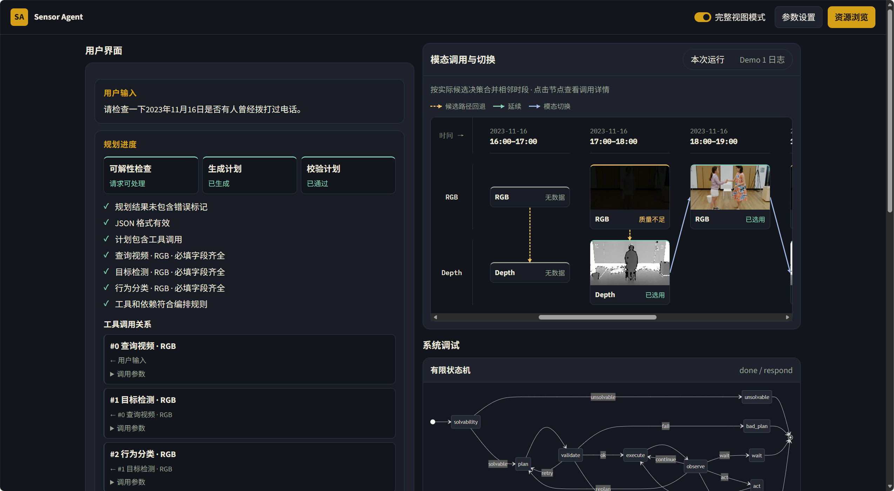

# Senor Agent

基于 LangGraph 的多模态传感器智能体，提供实时模态选择与回退、中文规划进度、完整视图、Markdown 回复，以及浏览器 ASR / TTS。




源代码与示例工具目录包含在仓库中，首次使用需填写模型接口、模型名称及 Cohere API 密钥。真实传感器数据与模型权重需自行配置。

```bash
git clone https://github.com/Tcatqwq/Senor-Agent.git
cd Senor-Agent
```

两条使用路径：

- **LLM 虚拟环境（只支持 Web）**：不读评测视频、不跑 YOLO/HAR，工具结果由 LLM 按设定的虚拟世界生成。
- **真实传感器数据（仓库中不包含数据与工具模型权重）**：读取本地 rgb/depth 视频，并用仓库外的模型权重做检测与行为识别。

---

## 环境要求

- Linux 或 WSL Ubuntu
- Conda，Python **3.10**
- Git（`requirements.txt` 会从 GitHub 安装 `torchvideotransforms`）


请使用独立环境 `senor-agent`。

---

## 安装

```bash
conda create -n senor-agent python=3.10 -y
conda activate senor-agent
cd /path/to/Senor-Agent
```

先安装与本机 CUDA 匹配的 PyTorch（`requirements.txt` 不含 torch）。CUDA 12.1 示例：

```bash
pip install torch==2.5.1 torchvision==0.20.1 torchaudio==2.5.1 \
  --index-url https://download.pytorch.org/whl/cu121
```

其他 CUDA / CPU 版本见 [pytorch.org](https://pytorch.org/get-started/locally/)。

然后：

```bash
pip install -r requirements.txt
```

说明：

- `setuptools` 必须保持在 `<82`，DeepSort 仍使用 `pkg_resources`。
- `torchvideotransforms` 来自 `git+https://github.com/hassony2/torch_videovision.git`，安装时需要能访问 GitHub。

---

## 配置

首次启动会从 `config/config.yaml.example` 创建本机配置 `config/config.yaml`，并初始化空缓存。请在启动后的 **参数设置** 中填写密钥和模型名称。默认使用 CPU 和 LLM 虚拟环境。

用编辑器或启动后的 **参数设置** 填写密钥。至少需要：

| 字段 | 用途 |
|---|---|
| `api_settings.vllm` | 规划与回复用的 OpenAI 兼容接口（`api_key` / `base_url` / `model`）。`llm_name` 保持 `deepseek-v3` 才会走这一段。 |
| `api_settings.cohere.api_key` | 规划阶段 RAG 示例检索的 embedding。 |

按使用方式再补：

| 字段 | 何时需要 |
|---|---|
| `llm_virtual_env.api` | 要开 Web 的 LLM 虚拟环境。可与上面的 vllm 用同一套 key。 |
| `execution_settings.sensor_database_path` | 真实 rgb/depth 视频目录。 |
| `execution_settings.model_checkpoint_paths` | HAR / depth 检测权重（需自行放到对应路径）。 |
| `execution_settings.device` | 默认 `cpu`；有 GPU 可改为 `cuda:0`。 |

密钥不要提交进 git。Web 里改密钥时留空表示不覆盖已有值。修改 `device` 或 `max_parallel_tools` 后需要**重启** `web_app.py`。

---

## 启动 Web

```bash
conda activate senor-agent
cd /path/to/Senor-Agent
python web_app.py
```

默认绑定 `127.0.0.1:8080`。本机浏览器打开 [http://127.0.0.1:8080](http://127.0.0.1:8080)。

也可以指定地址：

```bash
python web_app.py --host 127.0.0.1 --port 8080
```

首次启动会预热进程池，可能要等几秒到几十秒。系统调试页的状态机图会从 CDN 加载 Mermaid，需要能访问外网。

### 顶栏

**完整视图模式** 同页展示用户界面、实时模态流图与有限状态机。用户区通过中文进度卡实时展示可解性检查、规划和逐项校验。

| 入口 | 作用 |
|---|---|
| **用户界面** | 只显示请求、校验后的计划、最终回复。 |
| **系统调试** | 实时有限状态机 + 完整日志 + 状态 JSON。 |
| **模态流图** | 实时查看候选模态、正在执行的工具、回退原因和视频首帧，也可回放 Demo 1。 |
| **参数设置** | 改 API、Graph、Execution、LLM 虚拟环境，写入 `config.yaml`。 |
| **资源浏览** | 查看传感器文件、执行 cache、中间结果、工具与模型；也可配置虚拟世界。 |


示例查询：

```text
- 2023.11.16 房间中的人是否有打电话？
- 请使用 rgb、event、thermal 模态查看。2023.11.16 房间中的人都做了什么？
```

### 语音输入与朗读

输入框下方点击 **语音输入**，选择中文或英语，并允许浏览器使用麦克风。文字会实时填入输入框，停止后可以编辑并提交。语音输入使用浏览器的 Web Speech API，需要 HTTPS 或 `localhost` / `127.0.0.1`。浏览器支持情况及其语音服务的网络可用性会影响识别，内置浏览器可能不支持此功能。

回复卡片提供 **朗读回复**、**暂停 / 继续** 和 **停止朗读**。勾选 **自动朗读新回复** 后，本页新提交的任务完成时会朗读一次，刷新恢复历史回复时可以手动朗读。朗读使用浏览器及系统提供的中文或英语语音。

### 参数设置

四个页签：

- **API**：`vllm` / Cohere / 其他 provider 密钥与模型。
- **Graph**：重规划次数、校验重试、tick 间隔、并行工具数、`dry_run_sensor_tools`（`take-picture` / `send-notification` 默认不连真机）、监控关键词与主动通知标签。
- **Execution**：`dataset_name`、`device`、是否使用执行 cache、是否按小时自动选择 RGB / Depth。
- **LLM虚拟环境**：总开关、虚拟环境专用 LLM、清空虚拟 cache。

保存后大部分选项立即生效；`device` 与 `max_parallel_tools` 仍需重启进程。

### 资源浏览

分 **真实数据** / **LLM虚拟环境** 两种模式。

真实数据页签：

- **传感器数据**：按模态、日期浏览视频。
- **执行缓存** / **中间结果**：上次工具输出。
- **工具与模型**：当前 vocabulary 与权重路径。

虚拟环境模式可配置模态、日期范围、HAR 标签、工具依赖、环境描述，并 **重新生成 vocab/grammar**。关闭「虚拟模态」时，工具列表仍用真实 grammar，只有调用结果由 LLM 生成。

---

## LLM 虚拟环境（只支持 web）

不需要评测视频和模型权重。

1. 在 `config.yaml` 填好 `api_settings.vllm`、`api_settings.cohere`、`llm_virtual_env.api`。
2. 启动 `python web_app.py`，打开页面。
3. **参数设置 → LLM虚拟环境**：勾选「进入 LLM 虚拟环境模式」，保存。顶栏会出现绿色标记。
4. 打开 **资源浏览**，切到 **LLM虚拟环境**：填写日期、模态、环境描述（房间里发生了什么），必要时打开「虚拟模态」并点 **重新生成 vocab/grammar**。
5. **返回主界面**，提交一条带日期的查询。

虚拟环境与真实执行使用两套 cache；退出虚拟模式不会自动清空。重新生成 grammar 会清空虚拟 cache，也可在设置里手动清空。

---

## 真实传感器数据

虚拟环境关闭后，工具会读本地视频并加载模型。

启用 **按小时自动选择 RGB / Depth** 后，单路「视频查询 → 目标检测 → 可选行为分类」按小时执行。每个时段先尝试计划中的模态。RGB 平均亮度须大于 0.2，Depth 噪声标准差须小于 80。数据缺失、质量不足或结果不可用时会尝试另一模态。显式多模态计划和 LLM 虚拟环境按各自的计划执行。

1. 把 rgb / depth 目录写到 `execution_settings.sensor_database_path.inlab`。
2. 将权重放到 `external_files/execution_files/model_checkpoints/inlab/`：
   - `best_obj_depth.pt`
   - `best_har_rgb.pth`
   - `best_har_depth.pth`
3. `execution_settings.device` 设为实际 GPU，例如 `cuda:0`。
4. 确认 **参数设置 → LLM虚拟环境** 的总开关已关闭。

中间结果写在本仓库的 `external_files/`。首次关闭 cache 跑 YOLO/HAR 会较慢。

---

## 命令行（可选）

CLI **强制关闭** LLM 虚拟环境，传感器查询走真实路径。试用虚拟世界请用 Web。

```bash
conda activate senor-agent
cd /path/to/Senor-Agent

python cli.py --query "Did anyone show aggressive behaviors on 2023.11.16?"
python cli.py   # 交互模式，输入 exit 退出
```
---